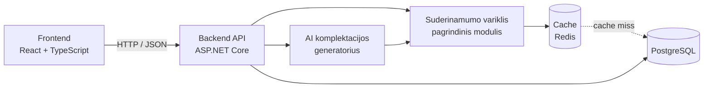

# AdvancedPCBuilder

*Programų sistemų projektavimas — Kursinio darbo I dalis (pataisyta versija, v2)*

## 1. Problema ir idėja

**Sistema vienu sakiniu:** Multitenant SaaS platforma kompiuterių surinkėjams bei parduotuvėms, skirta automatiškai tikrinti komplektuojamų dalių fizinį bei elektrinį suderinamumą ir optimizuoti PC parinkimą.

**Problema ir dabartinis procesas:** Surinkėjai ir pardavėjai naudoja rankinius patikrinimus arba bazines e-parduotuvių filtrų sistemas. Trūkumas – neįvertinami sudėtingi fiziniai matmenys (pvz., CPU aušintuvo aukštis vs. korpuso riba, RAM modulių aukštis vs. aušintuvo laisvas tarpas virš atminties lizdų), M.2 / SATA jungčių dalijimosi ribojimai ir maitinimo bloko galios atsarga.

**Nauda:** Sumažėja surinkimo klaidų bei grąžinimų skaičius, sutaupomas naudotojų laikas ir automatizuojamas reikalavimus atitinkančių stalo kompiuterių sąmatų sudarymas.

**Naudotojai:** Kompiuterinės technikos parduotuvės bei individualūs vartotojai, valdantys savo inventorių ir klientų komplektacijas.

**Prielaidos:** Daroma prielaida, kad parduotuvėms ir surinkėjams reikalingas tikslus fizinių matmenų bei elektrinių parametrų patikrinimas, o komponentų specifikacijos (matmenys, galia, jungtys) yra prieinamos iš gamintojų duomenų ir saugomos sistemos kataloge.

## 2. Apimtis

| Funkcija | Ką naudotojas galės atlikti | Pagrindinis modulis ar pagalbinė funkcija |
|---|---|---|
| Registracija ir nustatymai | Parduotuvė / surinkėjas susikuria paskyrą, valdydamas savo krepšelį ir antkainius. | Pagalbinė funkcija |
| Komplektacijos surinkimas | Naudotojas pasirenka komponentus iš sąrašo ir formuoja PC komplektaciją. | Pagalbinė funkcija |
| Suderinamumo ir ribojimų tikrinimas | Variklis atlieka fizinių matmenų, maitinimo galios, RAM ir M.2 / SATA jungčių taisyklių patikrinimą. | **Pagrindinis modulis** |
| AI komplektacijos generatorius | Naudotojas įveda biudžetą ir paskirtį, o dirbtinis intelektas pateikia pradinę komplektaciją patikrinimui. | Pagalbinė funkcija (AI) |

**Į kursinio darbo apimtį neįeina:** Realių mokėjimų apdorojimas, fizinis prekių pristatymo sekimas.

## 3. Pagrindinis modulis

**Pavadinimas ir atsakomybė:** Komponentų fizinio ir elektrinio suderinamumo variklis. Jis atsakingas už daugiakriterių taisyklių (matmenų, maitinimo, RAM ir jungčių konfliktų) patikrinimą ir validavimą, kai surenkamas kompiuteris.

**Logika, kurią reikės projektuoti ir testuoti:** Kiekviena taisyklė realizuojama kaip atskira klasė su bendra sąsaja (pvz., `ICompatibilityRule`), todėl taisykles galima testuoti izoliuotai ir pridėti naujas nekeičiant variklio (Strategy / Open-Closed principas). Variklis vykdo **visas** taisykles (nesustoja ties pirma klaida) ir surenka visus pažeidimus į vieną ataskaitą.

### 3.1. Įvestis ir išvestis

**Įvestis:** naudotojo suformuotas komponentų sąrašas JSON formatu (komponentų ID iš tenant'o katalogo). Pavyzdys:

```json
{
  "cpuId": "cpu-65w-am5",
  "motherboardId": "mb-matx-am5",
  "ram": { "id": "ram-ddr5-16-lp", "quantity": 2 },
  "gpuId": "gpu-200w-270mm",
  "cpuCoolerId": "cool-air-155",
  "caseId": "case-mid-360",
  "psuId": "psu-600",
  "storage": [ { "id": "ssd-m2-1tb", "quantity": 1 } ],
  "caseFans": 3
}
```

**Išvestis:** suderinamumo ataskaita JSON formatu su bendru statusu ir konkrečiais pažeidimais. Kiekvienas pažeidimas turi taisyklės kodą, lygį (`Error` / `Warning`), pranešimą ir skaitines reikšmes (faktinė, ribinė, skirtumas), kad testuose būtų galima tikrinti tikslius skaičius.

```json
{
  "status": "Rejected",
  "requiredPsuWatts": 600,
  "issues": [
    { "rule": "R2-COOLER-HEIGHT", "severity": "Error",
      "message": "CPU aušintuvo aukštis 170 mm viršija korpuso ribą 165 mm (trūksta 5 mm).",
      "actual": 170, "limit": 165, "difference": 5 },
    { "rule": "R5-PSU-POWER", "severity": "Error",
      "message": "Reikalinga PSU galia 600 W viršija pasirinkto PSU galią 450 W (trūksta 150 W).",
      "actual": 600, "limit": 450, "difference": 150 }
  ]
}
```

**Statuso nustatymas:**

- yra bent viena `Error` → **Atmesta** (`Rejected`);
- nėra `Error`, bet yra bent vienas `Warning` → **Patvirtinta su įspėjimais** (`ApprovedWithWarnings`);
- pažeidimų nėra → **Patvirtinta** (`Approved`).

### 3.2. Veikimo eiga

1. Sistema priima pasirinktų komponentų užklausą (su tenant'o identifikatoriumi).
2. Iš duomenų bazės (arba cache atminties) ištraukiamos komponentų specifikacijos.
3. Patikrinama, ar visi privalomi komponentai pasirinkti (CPU, motininė plokštė, RAM, korpusas, PSU); jei ne – grąžinama validacijos klaida (HTTP 400), taisyklės nevykdomos.
4. Vykdomos fizinio suderinamumo taisyklės (R1–R4).
5. Vykdomos elektrinės, RAM ir jungčių taisyklės (R5–R8).
6. Iš surinktų pažeidimų nustatomas statusas ir suformuojama ataskaita, kuri grąžinama vartotojo sąsajai.

### 3.3. Komponentų duomenys, kurių reikia taisyklėms

| Komponentas | Laukai, naudojami taisyklėse |
|---|---|
| CPU | `socket`, `tdpW` |
| Motininė plokštė | `formFactor` (E-ATX / ATX / mATX / Mini-ITX), `socket`, `memoryType` (DDR4 / DDR5), `dimmSlots`, `m2Slots` (sąrašas su `sharedSataPorts`), `sataPorts` |
| RAM (vienas modulis) | `memoryType`, `heightMm` |
| GPU | `lengthMm`, `boardPowerW` (TBP) |
| CPU aušintuvas | `type` (Air / AIO), oro: `heightMm`, `ramClearanceMm`; AIO: `radiatorSizeMm`, `radiatorThicknessMm` (radiatorius + ventiliatoriai) |
| Korpusas | `supportedFormFactors`, `maxCoolerHeightMm`, `maxGpuLengthMm`, `supportedFrontRadiatorsMm` |
| PSU | `wattage` |
| Kaupikliai | `interface` (M.2 / SATA) |

**Galios modelis (W).** CPU – `tdpW`, GPU – `boardPowerW`. Kitiems komponentams naudojamos fiksuotos konservatyvios konstantos (saugomos konfigūracijoje, ne kode):

| Komponentas | Galia |
|---|---|
| Motininė plokštė | 50 W |
| RAM modulis | 5 W / vnt. |
| M.2 SSD | 8 W / vnt. |
| SATA SSD / HDD | 5 W / 10 W / vnt. |
| Ventiliatorius (korpuso ar aušintuvo) | 3 W / vnt. |
| AIO pompa | 5 W |

### 3.4. Taisyklės (prototipo apimtis)

Visi skaičiavimai atliekami sveikaisiais skaičiais (mm, W), todėl nėra slankiojo kablelio apvalinimo klaidų ribiniuose atvejuose. Lygybė ribai visada laikoma **tinkama** (naudojamas `≤`).

| Kodas | Taisyklė | Formulė / sąlyga | Lygis |
|---|---|---|---|
| R1-FORM-FACTOR | Motininės plokštės formatas palaikomas korpuso | `mb.formFactor ∈ case.supportedFormFactors` | Error |
| R2-COOLER-HEIGHT | Oro aušintuvo aukštis telpa korpuse | `cooler.heightMm ≤ case.maxCoolerHeightMm`; trūkumas = `cooler.heightMm − case.maxCoolerHeightMm` | Error |
| R2b-RADIATOR-MOUNT | AIO radiatorius telpa priekinėje korpuso vietoje | `cooler.radiatorSizeMm ∈ case.supportedFrontRadiatorsMm` | Error |
| R3-GPU-LENGTH | GPU ilgis telpa įvertinus priekinį radiatorių | `gpu.lengthMm ≤ case.maxGpuLengthMm − radiatorThicknessMm` (oro aušintuvui `radiatorThicknessMm = 0`) | Error |
| R4-SOCKET | CPU lizdas atitinka motininės plokštės lizdą | `cpu.socket = mb.socket` | Error |
| R5-PSU-POWER | PSU galia su 20 % atsarga | `P = Σ komponentų galių`; `required = ⌈P × 12 / 10⌉`; jei `required > psu.wattage` → Error; jei `required > psu.wattage × 9 / 10` → Warning (liko < 10 % atsargos atnaujinimams) | Error / Warning |
| R6-RAM-TYPE | RAM tipas ir kiekis atitinka motininę plokštę | `ram.memoryType = mb.memoryType` **ir** `ram.quantity ≤ mb.dimmSlots` | Error |
| R7-RAM-CLEARANCE | RAM aukštis telpa po oro aušintuvu | tik `cooler.type = Air`: `ram.heightMm ≤ cooler.ramClearanceMm`; trūkumas = `ram.heightMm − cooler.ramClearanceMm` | Error |
| R8-M2-SATA | M.2 ir SATA jungčių dalijimasis | žr. žemiau | Error / Warning |

**R8-M2-SATA algoritmas:**

1. Jei `m2Count > mb.m2Slots.Count` → Error („per daug M.2 diskų“).
2. M.2 diskai deterministiškai priskiriami lizdams iš eilės: M2_1, M2_2, …
3. `disabledSata = ⋃ sharedSataPorts` visiems užimtiems M.2 lizdams.
4. `availableSata = mb.sataPorts − |disabledSata|`.
5. Jei `sataCount > availableSata` → Error („M.2 diskas lizde M2_2 išjungia SATA5–6; reikia 5 SATA prievadų, prieinami 4“).
6. Jei `disabledSata ≠ ∅` ir `sataCount ≤ availableSata` → Warning (informuojama, kurie prievadai išjungti).

**Sąmoningai už prototipo apimties** (gali būti pridėta 3 etape kaip naujos `ICompatibilityRule` klasės, nekeičiant variklio):

- PCIe pralaidumo skaičiavimai (CPU / chipset linijų skaičius, x16 → x8 dalijimasis, PCIe kartų suderinamumas);
- detalus momentinių apkrovų (transient spikes) modeliavimas – prototipe jį aproksimuoja 20 % atsarga taisyklėje R5;
- GPU maitinimo jungčių (8-pin / 12VHPWR) ir PSU jungčių kiekio tikrinimas;
- RAM greičio / QVL suderinamumas, galinio / viršutinio radiatoriaus montavimas.

### 3.5. Scenarijai būsimiems testams (su tiksliais skaičiavimais)

**S1. Įprastas atvejis (sėkmingas patikrinimas)**

Pradinės sąlygos ir įvestis:

| Komponentas | Parametrai | Galia |
|---|---|---|
| CPU | AM5, TDP 65 W | 65 W |
| Motininė plokštė | mATX, AM5, DDR5, 4 DIMM, 2 M.2 (M2_2 dalijasi SATA5–6), 6 SATA | 50 W |
| RAM | 2 × DDR5, aukštis 34 mm | 2 × 5 = 10 W |
| GPU | ilgis 270 mm, TBP 200 W | 200 W |
| CPU aušintuvas | oro, aukštis 155 mm, RAM tarpas 40 mm, 1 ventiliatorius | 3 W |
| Korpusas | palaiko ATX / mATX / Mini-ITX; maks. aušintuvas 165 mm; maks. GPU 360 mm; priekinio radiatoriaus nėra (0 mm); 3 ventiliatoriai | 3 × 3 = 9 W |
| Kaupiklis | 1 × M.2 SSD (lizdas M2_1, nieko neišjungia) | 8 W |
| PSU | 600 W | — |
| **Suma P** | | **345 W** |

Taisyklių skaičiavimai:

| Taisyklė | Skaičiavimas | Rezultatas |
|---|---|---|
| R1 | mATX ∈ {ATX, mATX, Mini-ITX} | OK |
| R2 | 155 ≤ 165 (atsarga 10 mm) | OK |
| R3 | 270 ≤ 360 − 0 = 360 (atsarga 90 mm) | OK |
| R4 | AM5 = AM5 | OK |
| R5 | required = ⌈345 × 1,2⌉ = 414 W; 414 ≤ 600 ir 414 ≤ 540 (0,9 × 600) | OK (atsarga 186 W) |
| R6 | DDR5 = DDR5; 2 ≤ 4 | OK |
| R7 | 34 ≤ 40 (atsarga 6 mm) | OK |
| R8 | 1 ≤ 2 M.2 lizdų; M2_1 neišjungia SATA; 0 SATA įrenginių ≤ 6 | OK |

Laukiamas rezultatas: statusas **Patvirtinta**, `requiredPsuWatts = 414`, pažeidimų sąrašas tuščias.

**S2. Įprastas atvejis su AIO ir GPU ilgio riba**

Įvestis: ATX motininė plokštė (AM5, DDR5), CPU 120 W; AIO 240 mm priekyje, radiatoriaus su ventiliatoriais storis 27 + 25 = 52 mm; korpusas maks. GPU 360 mm, priekyje palaiko 240 / 280 / 360 mm radiatorius; GPU ilgis **308 mm**, TBP 220 W; 2 × RAM 56 mm; 1 × M.2; 2 korpuso ventiliatoriai; PSU 750 W.

- R2b: 240 ∈ {240, 280, 360} → OK.
- R3: 308 ≤ 360 − 52 = 308 → OK (lygybė leidžiama, atsarga 0 mm).
- R7: netaikoma (AIO neužstoja RAM lizdų), todėl 56 mm RAM tinka.
- R5: P = 120 + 50 + 10 + 220 + 8 + (5 pompa + 2 × 3 ventiliatoriai) + 2 × 3 = 425 W; required = ⌈425 × 1,2⌉ = 510 W ≤ 675 W (0,9 × 750) → OK.

Laukiamas rezultatas: **Patvirtinta**, pažeidimų nėra. Porinis testas: GPU 309 mm → **Atmesta**, R3 „GPU ilgis 309 mm viršija laisvą vietą 308 mm (trūksta 1 mm)“.

**S3. Ribinis atvejis – PSU galia**

Įvestis: CPU 120 W, motininė plokštė 50 W, 2 × RAM (10 W), GPU 425 W, 1 × M.2 (8 W), oro aušintuvas su 2 ventiliatoriais (6 W), 2 korpuso ventiliatoriai (6 W); PSU 750 W. Visi matmenys telpa su atsarga.

- P = 120 + 50 + 10 + 425 + 8 + 6 + 6 = **625 W**; required = ⌈625 × 12 / 10⌉ = **750 W**.
- 750 ≤ 750 → nėra klaidos; 750 > 675 (0,9 × 750) → Warning.

Laukiamas rezultatas: **Patvirtinta su įspėjimais**, vienas R5 Warning: „Reikalinga PSU galia 750 W lygi PSU galiai 750 W – nėra atsargos atnaujinimams“. Porinis testas: P = 626 W → required = ⌈751,2⌉ = 752 W > 750 W → **Atmesta**, R5 Error (trūksta 2 W).

**S4. Klaida – formatas netelpa**

Įvestis: E-ATX motininė plokštė, Mini-ITX korpusas (palaiko tik Mini-ITX), kiti komponentai tinkami.

- R1: E-ATX ∉ {Mini-ITX} → Error.

Laukiamas rezultatas: **Atmesta**, pranešimas „Motininės plokštės formatas E-ATX netelpa į pasirinktą Mini-ITX korpusą“.

**S5. Klaida – RAM aukštis po oro aušintuvu**

Įvestis: bokštinis oro aušintuvas (aukštis 165 mm, RAM tarpas 32 mm), korpusas maks. aušintuvas 165 mm, aukšto profilio RAM 56 mm.

- R2: 165 ≤ 165 → OK (riba pasiekta, bet neviršyta).
- R7: 56 > 32 → Error, trūkumas 56 − 32 = 24 mm.

Laukiamas rezultatas: **Atmesta**, pranešimas „RAM modulių aukštis 56 mm viršija aušintuvo laisvą tarpą 32 mm (trūksta 24 mm)“.

**S6. Klaida / įspėjimas – M.2 ir SATA dalijimasis**

Įvestis: motininė plokštė su 6 SATA prievadais ir 2 M.2 lizdais (M2_2 dalijasi SATA5–6); 2 × M.2 SSD.

- a) 5 SATA diskai: disabled = {SATA5, SATA6}; available = 6 − 2 = 4; 5 > 4 → **Atmesta**, R8 Error.
- b) 4 SATA diskai: 4 ≤ 4, bet prievadai išjungti → **Patvirtinta su įspėjimais**, R8 Warning „M2_2 naudojimas išjungia SATA5–6“.

**S7. Kelios klaidos vienu metu (demonstracinis scenarijus)**

Įvestis: CPU 170 W, motininė plokštė 50 W, 2 × RAM (10 W), GPU 250 W, 1 × M.2 (8 W), oro aušintuvas 170 mm su 2 ventiliatoriais (6 W), 2 korpuso ventiliatoriai (6 W); korpusas maks. aušintuvas 165 mm; PSU 450 W.

- R2: 170 > 165 → Error (trūksta 5 mm).
- R5: P = 170 + 50 + 10 + 250 + 8 + 6 + 6 = 500 W; required = ⌈500 × 1,2⌉ = 600 W > 450 W → Error (trūksta 150 W).

Laukiamas rezultatas: **Atmesta** su **abiem** klaidomis (variklis nesustoja ties pirma klaida).

**Jei modulis naudoja AI:** Netaikoma. Pagrindinis modulis yra deterministinis; AI naudojamas tik pagalbinėje komplektacijos generavimo funkcijoje, kurios rezultatą tikrina šis variklis.

## 4. Kokybės atributas

**Pasirinktas atributas:** Spartumas (Našumas / Performance).

**Kodėl svarbus šiai sistemai:** Komplektuojant kompiuterį e-parduotuvėse, vartotojai tikisi momentinio (realiu laiku) suderinamumo patikrinimo po kiekvieno detalės pakeitimo. Kadangi tai yra SaaS sistema, ji vienu metu aptarnaus daugybės skirtingų klientų (tenantų) vartotojus. Taisyklių tikrinimo variklis privalo veikti greitai ir neblokuoti serverio resursų, antraip sistema taps nepatogi naudoti.

**Tikrinimo scenarijus ir sąlygos:** Bus simuliuojama didelė lygiagreti API apkrova. Į suderinamumo tikrinimo modulį (API) vienu metu bus išsiųsta 500 užklausų, kur kiekviena užklausa turės 8–10 skirtingų komponentų komplektaciją iš atsitiktinių tenantų.

**Sėkmės kriterijus:** 95 % API patikrinimo užklausų (p95) apdorojamos ir atsakymas grąžinamas greičiau nei per 200 milisekundžių. Neįvykusių užklausų (klaidų, pvz., HTTP 500 ar timeout) procentas lygus 0 %.

**Numatytas projektavimo sprendimas:** Sistema bus projektuojama naudojant stateless (būsenos nesaugančią) architektūrą. Taisyklių variklis yra grynas skaičiavimas be I/O (gauna jau užkrautas specifikacijas), o komponentų specifikacijos laikomos greitojoje atmintyje, kad skaičiavimų metu nereikėtų kreiptis į duomenų bazę.

**Kaip patikrinsiu vėlesniame etape:** Sukursiu ir paleisiu automatizuotą apkrovos testavimo skriptą su specializuotu įrankiu (pvz., „k6“ arba „NBomber“). Įrankis sugeneruos ataskaitą su API atsako laiko matavimais (p50 / p95 / p99, klaidų procentas) prie nurodytos apkrovos. Matavimai bus atlikti su cache ir be jo, kad būtų matomas sprendimo poveikis.

**Sprendimo kaina arba ribojimas:** Greitosios atminties (caching) naudojimas padidina serverio operatyviosios atminties (RAM) sąnaudas ir reikalauja cache invalidavimo, kai tenant'as pakeičia katalogą.

## 5. Pradinė sistemos struktūra



| Sistemos dalis | Atsakomybė |
|---|---|
| Naudotojo sąsaja (Frontend) | Priima vartotojo įvestį, atvaizduoja vizualų komponentų pasirinkimą ir klaidas/įspėjimus, grįžtančius iš API. |
| Backend API | Priima HTTP užklausas iš Frontend'o, tikrina autentifikaciją, nustato, iš kokio tenant'o ateina užklausa, ir nukreipia ją atitinkamam moduliui. |
| Suderinamumo patikrinimas (Pagrindinis modulis) | Vykdo taisykles R1–R8 fiziniam ir elektriniam suderinamumui tikrinti, naudodamas duomenis iš greitosios atminties. |
| Duomenų bazė | Saugo komponentų specifikacijas, tenant'ų nustatymus, vartotojų paskyras ir išsaugotas komplektacijas. |
| Greitoji atmintis (Cache) | Laiko komponentų specifikacijas, kad suderinamumo variklis galėtų atlikti skaičiavimus išvengiant lėtų DB užklausų. |

**Planuojamos technologijos ir pasirinkimo priežastys:**

- **C# (.NET 8 / ASP.NET Core)** – Backend API ir pagrindinės skaičiavimo logikos kūrimui. Pasirinkta dėl didelio našumo, stipraus tipizavimo bei asmeninio susidomėjimo šia technologija ir noro tobulinti žinias objektinio programavimo srityje.
- **TypeScript ir React** – Vartotojo sąsajai kurti. TypeScript pasirinktas dėl tipų saugumo, o React leidžia lengvai kurti interaktyvias sąsajas.
- **PostgreSQL** – Pagrindiniams sistemos reliaciniams duomenims (tenant'ams, komponentų katalogui) saugoti. Pasirinkta dėl patikimumo, atviro kodo ir lengvo integravimo su .NET per Entity Framework.
- **Redis** – Greitajai (in-memory) atminčiai realizuoti, kurios reikės pagrindinio modulio našumui (kokybės atributui) pasiekti.
- **Docker** – Sistemos konteinerizavimui, užtikrinant „SaaS / Cloud-first“ principą, leidžiantį sistemą paleisti viena komanda iš README failo.
- **GitHub** – Kodo versijavimui ir projekto dokumentacijai.

## 6. AI panaudojimas

### AI rengiant šį dokumentą

| Priemonė ir užduotis | Ką panaudojau | Ką atmečiau arba perrašiau ir kodėl | Kaip patikrinau |
|---|---|---|---|
| Pagrindinės sistemos problemos bei naudos apibrėžimas | Gemini | Ištryniau nereikalingus sakinius, daug nereikalingų paaiškinimų skliaustuose | Perskaičiau |
| Pradinės sistemos struktūros schemos generavimas (Mermaid formatu) | Gemini | Palikau kaip yra | Peržiūrėjau |
| Technologijų pasirinkimas | Gemini | Pašalinau Angular ir Vue, nes nesu su jais dirbęs; pagrindinę programavimo kalbą pakeičiau į C#, nes noriu su ja įgyvendinti projektą | Perskaičiau |
| Tolesnių darbų plano lentelės užpildymas | Gemini | Atmečiau planus, kurie buvo netinkami | Perskaičiau sugeneruotą lentelę, išanalizavau kiekvieną įrašą |
| 3 skyriaus taisyklių ir testų scenarijų patikslinimas pagal dėstytojo atsiliepimą | Claude | *(užpildyti: ką pakeitėte / atmetėte)* | Perskaičiavau kiekvieno scenarijaus sumas ir ribas ranka |

### Planuojamas AI naudojimas kuriant sistemą

**Įrankiai:** į IDE integruoti įrankiai, autofill, kalbos modeliai (Copilot, Gemini, Claude Code).

**Kur ir kam naudosiu AI:** Rašant pasikartojantį kodą, generuojant testinius PC komponentų duomenis duomenų bazei, sprendžiant „Docker“ konfigūracijos klaidas bei ieškant patarimų, kaip geriau realizuoti C# skaičiavimo taisykles.

**Kaip tikrinsiu pasiūlymus ir sugeneruotą kodą:** Kiekvieną sugeneruotą kodo bloką perskaitysiu ir analizuosiu. Pagrindinio modulio logikai taikysiu unit testus pagal 3.5 skyriaus scenarijus. Nenaudosiu kodo, kurio pats negalėčiau paaiškinti atsiskaitymo metu.

**Ar AI bus sistemos funkcionalumo dalis:** Taip. AI bus naudojamas kaip papildoma funkcija. Jo paskirtis – pagal vartotojo įvestą tekstą (pvz., biudžetą ir paskirtį) sugeneruoti pradinį kompiuterio komponentų sąrašą, kurį vėliau validuos pagrindinis suderinamumo variklis.

## 7. Tolesnių darbų planas

| Darbas | Apčiuopiamas rezultatas | Seka |
|---|---|---|
| Projekto ir Docker aplinkos paruošimas | Sukurta repozitorija, veikiantis tuščias .NET API ir PostgreSQL paleidžiami viena `docker compose up` komanda. | 1 |
| Duomenų bazės struktūra ir pavyzdiniai duomenys | Sukurtos lentelės komponentams ir tenant'ams su 3.3 skyriaus laukais. Duomenų bazė užpildyta komponentais, reikalingais scenarijams S1–S7. | 2 |
| Pagrindinio modulio logika | Sukurtos C# taisyklių klasės R1–R8 ir variklis (be API prijungimo). Parašyti unit testai scenarijams S1–S7 ir poriniams ribiniams testams. | 3 |
| API endpoint'ai bei Redis integracija | Sukurti REST API endpoint'ai, priimantys užklausas. Variklis sujungtas su cache. | 4 |
| Vartotojo sąsajos sukūrimas | Paprastas internetinis puslapis, kuriame išskleidžiamųjų sąrašų pagalba galima pasirinkti komponentus ir iškviesti API patikrinimą. | 5 |
| AI komponento integracija | Pridėtas tekstinis įvesties laukas, kur API per kalbos modelį sugeneruoja pradinę kompiuterio komplektaciją pagal vartotojo biudžetą. | 6 |

**Būsimo prototipo veikimo scenarijus:** Prototipo demonstravimo metu bus parodyta, kaip vartotojas išsirenka komponentus imituotoje e-parduotuvės aplinkoje. Pirmiausia bus pateikta nesuderinama komplektacija (scenarijus S7): 170 W procesorius, 170 mm aukščio aušintuvas, korpusas su 165 mm riba ir 450 W maitinimo blokas. Paspaudus „Tikrinti“, sistema per mažiau nei 200 ms grąžins atmetimo atsakymą su abiem klaidomis: „trūksta 5 mm aušintuvui“ ir „PSU trūksta 150 W“ (reikia 600 W). Antru žingsniu aušintuvas bus pakeistas į 155 mm modelį, o PSU – į 750 W (600 ≤ 675, todėl be įspėjimo); sistema perskaičiuos ir grąžins statusą „Patvirtinta“.

| Rizika arba neaiškumas | Kaip patikrinsiu arba sumažinsiu |
|---|---|
| Suderinamumo taisyklių variklis pasidarys per daug sudėtingas ir bus sunku rasti klaidą. | Kiekviena taisyklė – atskira klasė su savo unit testais; pereinu prie kitos taisyklės tik kai ankstesnės testai praeina. |
| Redis integravimas neveiks sklandžiai arba grąžins senus duomenis. | Iš pradžių sistema veiks tiesiogiai su duomenų baze. Redis sluoksnį pridėsiu tik tada, kai pagrindinė logika veiks, kaip optimizaciją už sąsajos (pvz., `IComponentRepository`). |
| Fiksuotos galios konstantos (motininė plokštė, RAM, ventiliatoriai) neatitiks realių verčių. | Konstantos laikomos konfigūracijoje; dokumentuojama, kad tai konservatyvi aproksimacija, o ne matavimas. |

## 8. Pakeitimai po dėstytojo vertinimo

- 3 skyriaus sėkmingam scenarijui (S1) pateikta visų komponentų suminė galia (345 W → reikalinga 414 W), aušintuvo ir korpuso ribiniai aukščiai (155 / 165 mm), GPU ilgis (270 mm), radiatoriaus storis (0 mm) ir RAM tarpas (34 / 40 mm).
- Prie kiekvieno scenarijaus pateikti tikslūs taisyklių skaičiavimai; pridėti poriniai ribiniai testai (308 / 309 mm, 625 / 626 W).
- Apibrėžtos RAM taisyklės (R6 tipas ir kiekis, R7 aukštis po aušintuvu) ir M.2 / SATA dalijimosi taisyklė (R8). PCIe pralaidumo / linijų skaičiavimai aiškiai palikti už prototipo apimties.
- Pridėtos taisyklės R1 (formatas) ir R4 (lizdas), nes ankstesniame klaidos scenarijuje naudota formato taisyklė nebuvo aprašyta taisyklių sąraše.
- Patikslintas ribinis PSU atvejis: lygybė laikoma tinkama, o < 10 % atsarga – įspėjimas; apibrėžti trys statusai.
- Ištaisytas pavyzdinis išvesties pranešimas (ankstesnis „aušintuvo ir RAM aukščių suma viršija korpuso plotį“ neatitiko realaus fizinio konflikto).

## Šaltiniai

Nenaudojau.
